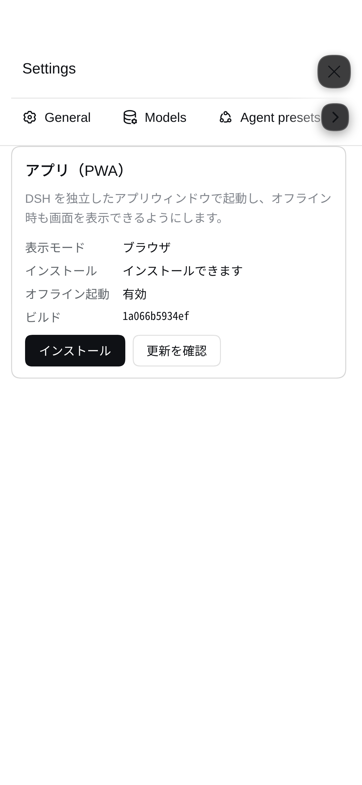

# 使い方（日本語）

`dsh-mobile-maxxing` の詳しい説明です。**インストールは [README](../README.md#インストール) を見てください。**

English: [USAGE.en.md](USAGE.en.md)


## このパッケージについて

もともと別々だった3つのプラグインを1つにまとめたものです。CJK 修正だけは、PC 側の描画を
変えない方針のため別パッケージのままです。

| 元 | いま |
| --- | --- |
| `rdsh-pwa` | PWA（インストール可能化・オフライン起動・通知の送受信・通知音） |
| `rdsh-mobile-ux` | モバイル端末のUX（ドロワー・設定・入力・コード表示・アプリ内バナー） |
| `rdsh-session-id-copy` | セッションメニューにセッションIDのコピー行を足す |
| `rdsh-markdown-cjk`（別パッケージ） | CJK の自動リンク崩れ修正。本体にはマウントしません |

**分けていない理由**: DSH のクライアントモジュールシステムは1パッケージ＝1ブラウザモジュールです。
別パッケージにするとその分だけ別モジュールとして登録され、インストール・設定・有効化が
分散します。中身は互いに独立しているので、1つにまとめても干渉しません。CJK 修正だけは
PC の描画を書き換えるため、このパッケージには含めず任意の別パッケージにしています。

## できること

| 機能 | 内容 |
| --- | --- |
| インストール | Chrome / Edge / Android で「アプリをインストール」。192/512px + maskable アイコン、`display: standalone`、`launch_handler: focus-existing`（アイコン再タップで既存ウィンドウを前面に） |
| オフライン起動 | アプリシェルをキャッシュし、圏外でも画面が出る（`/api` は絶対にキャッシュしない）。接続が戻ると自動で通常動作に戻る |
| ホーム画面 | iOS 用 `apple-touch-icon` / `apple-mobile-web-app-status-bar-style`、`format-detection: telephone=no`。`apple-mobile-web-app-capable` / `apple-mobile-web-app-title` / `application-name` は**付けない**（iOS 26 でレガシーな view frame になり、下にステータスバー分の未描画帯が出るため）。standalone は manifest の `display` で指定 |
| セーフエリア | モバイルモードで `env(safe-area-inset-*)` を `#root`・固定レイヤー（ドロワー、FAB、設定、右パネル）・ポップオーバーに反映。縦横どちらのノッチにも従う（#59） |
| キーボード | `interactive-widget=resizes-content` で、ソフトキーボード表示時に入力欄が隠れない |
| インストール導線 | サイドバー下部のアイコン、スマホ用カード（「あとで」で30日スヌーズ）、設定 →「モバイル」内のアプリ設定 |
| 更新通知 | 新しいビルドのサービスワーカーが待機したら「新しいバージョンがあります → 再読み込み」。勝手にリロードはしない（実行中のセッションを壊さない） |
| オフライン表示 | 上部に「オフライン — 再接続を待っています」 |
| Web Push | このパッケージ独自実装（`dsh-notify-push` 不要）。前面はアプリ内バナー、背面は OS 通知 |

## 見た目

モバイル端末ではヘッダー下にインストールカード（「あとで」で30日スヌーズ）、サイドバー下部には
インストールアイコンが出ます。設定 →「モバイル」内のアプリ設定で状態と操作をまとめて確認できます。





### 設定は「モバイル」1タブに統合

このプラグインが追加するタブは **設定 →「モバイル」** だけです。端末別テーマ、通知・通知音、
Enterキーの動作、アプリのインストール・更新・状態をまとめています。「アプリ」「入力」の別タブは登録しません。
非表示操作の一覧・解除・追加ラベル編集、基本状態、画面サイズ診断、スクロール診断は削除しました。
モバイルで不要な操作を隠す標準動作は維持し、古いブラウザ保存の非表示カスタマイズは読み込みません。
ブラウザの保存データ自体は削除しません。PCには設定を追加しません。

### この端末だけの表示・権限

「モバイル」には、このブラウザだけに効く設定が入ります。どれも `localStorage` に保存し、
DSH の共有設定（ホストのプロファイル）は書き換えません。

| 設定 | 動き |
| --- | --- |
| 文字サイズ（本文／コード／ターミナル） | この端末の表示だけを変えます。共有の外観設定はそのまま |
| 表示言語 | この端末の UI 言語だけを変えます。登録済みの言語だけが選べます（この端末では日本語も選べます） |
| 権限の既定 | この端末で始める新しいセッションにだけ適用します。共有の既定はそのまま |

権限の既定は、新しいセッションを開いた直後にそのセッション自身の `/permission` として
記録します。ホストの `defaultPreset` は変更しません。適用が終わるまでは入力欄を
一時的に無効にするため、選んだ権限で最初の送信から動きます。

作業詳細の表示量・折りたたみ時機・実行中送信動作・性能表示は、上流が端末別の
設定 API を公開していないため、この版には入れていません（共有設定を書き換えずに
端末別へ分離できないため）。

### テーマ（ライト／ダーク）

配色は DSH 本体のテーマトークン（`--dsw-*`）から取ります。以前はダークの色を直接
書いていたため、ライトテーマではサイドバーの選択行・ポップオーバー・トースト・設定の
ボタンがほぼ読めませんでした。現在はライト／ダークのどちらでも上流のパレットに従います。

設定 →「モバイル」→「テーマ（この端末だけ）」で、このブラウザだけ配色を選べます
（共有設定に従う／ライト／ダーク／端末に合わせる）。値は `localStorage` にだけ保存し、
DSH のプロファイル設定は書き換えないので、**スマホで変えても PC には伝わりません**。
PC と共通のテーマは 設定 → 一般 → 外観 です。

- 上流の DOM 契約（`body[data-ds-dark-theme]` / `html{color-scheme}`）が変わっていた場合は、
  適用後に検査して**上書きを諦め、共有テーマに戻ります**（設定に理由が出ます）。
- 登録テーマ（カスタムパレット）を使っている間はトークンが混ざるため、上書きは無効です。
- インストール済みアプリのスプラッシュとタスク切替の色は manifest の `themeColor` 固定で、
  端末別にはなりません。ライト固定で使うなら profile patch で `themeColor` /
  `backgroundColor` を `#fff` にしてください。
- ステータスバーの文字色は1つの meta では切り替えられないため、既定は旧構成と同じ
  `black-translucent`（暗い背景に白文字）です。ライト固定で黒文字にするときは profile patch で
  `appleStatusBarStyle: "default"` を指定してください。

### 言語

`lang` の既定は `ja` です。ホストは正規化した値を index の
`globalThis.__RDSH_PWA_LANG__` に注入し、このパッケージのブラウザ側は `document.lang` より
これを優先します（シェルの `document.lang` は書き換えません）。manifest・サービスワーカーの
オフライン表示・通知文面も同じ値に従います（通知だけ変えたいときは `notifications.lang` を
明示してください）。`lang: "en"` を指定すると、ブラウザ側・SW・manifest・通知がすべて英語に
なります。辞書に未訳のキーがある場合は英語にフォールバックします。

この端末の「表示言語」には `ja` 言語パックを追加しています。上流の共通語彙（`common`）と
設定画面（`settings` / `settings.locale`）を翻訳し、それ以外の名前空間は上流の
`ja` → `en` フォールバックで英語のまま表示されます（未訳の画面を推測で埋めません）。
PC の言語一覧は変わりません。

## モバイル向けUX

インストールしたアプリの**使い勝手**を担当する部分です。セッション一覧をオーバーレイのドロワーにし、
モバイルでは Settings を積み、タップと長押しを分け、通知設定と「モバイルでは使えない操作」の非表示
リストを提供します。追加インストールは不要です。

端末モードは**幅ではなく端末**で決まります。ホストが `<head>` 先頭に注入した小さな脚本が、
ブラウザ上で 1 回だけ判定して `globalThis.__RDSH_DEVICE_MODE__` と
`html[data-rdsh-device-mode]` を書きます。属性は mobile のときだけで、desktop では付きません
（同一の HTML/JS を全端末に配信し、SSR はしません）。クライアントはその値を使うだけで、
UA・幅・ポインタ種別・タッチ点数から判定し直しません。

読み込み順は、**有効な `__RDSH_DEVICE_MODE__` → 有効な
`html[data-rdsh-device-mode]` → どちらも無効なら desktop**（fail closed）です。
矛盾する場合は global が優先されます。desktop ではクライアントは**何も構築せず**
（PWA・設定タブ・セッションIDコピー等すべての part を適用せず）、DOM・style・listener・
storage のいずれにも触れません。

- スマホ（iPhone/Android、縦横とも）とタブレット（iPad、Android タブレット）は mobile。
  iPadOS のデスクトップ版 UA（Macintosh + `maxTouchPoints`）もタブレットとして mobile。
- 通常の PC、**タッチ対応 Windows PC**、幅の狭いデスクトップ窓は desktop。
  タッチできることだけを理由に mobile にはしません。
- 幅を 767px の前後に行き来してもモードは変わりません。幅はレイアウトの寸法と
  Settings の表示（狭い/広い）だけに使います。
- bootstrap を含まない古い HTML に**新版 client** がロードされた場合（例: 更新前の shell を
  offline で開いた場合）は desktop になります。次の online 起動で HTML が更新されます。
  旧 bundle 自身は旧 width コードのままなので、旧 offline がすべて desktop になるわけでは
  ありません。
- Android タブレットで「PC版サイト」を要求して UA から Android が消えた場合など、
  識別できないことがあります。判定は完全ではありません。

レイアウト（サイドバー→ドロワー）も同じモードで決まります。幅でモードは変わりませんが、
右パネルだけは **768px 以上**で会話の横にドックし（上流のドック表示）、768px 未満では
従来どおり全画面シートになります。既存の 380px 以下のコンポーザー圧縮は寸法調整として残しています。

ターミナル上部には、キーボード表示中でも隠れない Esc / Tab / 矢印 / Ctrl のキー行が出ます。
Ctrl は次の1キーにだけ効き、Ctrl の次に C を押すと SIGINT になります。もう一度 Ctrl を押すと解除できます。

実行中セッションのラベルの動きは `mobileUx.runningAnimation` で選べます（`aurora` /
`breathing` / `outline` / `none`、既定は `outline`）。3案のモックアップはリポジトリの
`packages/dsh-mobile-maxxing/mockups/` にあります（配布物には含みません）。

mobile モードでだけ効く装飾（セッション行の実行中アニメ・枠色・画像ビューアの上書き・出力速度の
表示）は、モード専用のスタイルシートに入っています。desktop では素の DSH と同じ見た目になります。

テキストプレビューは既定で折り返し、右上の折り返しボタンで解除できます。解除すると長い行は
横にスクロールできます。

コードレビューは折り返しONで開きます。レビューごとに折り返しをOFFにでき、その選択は同じタブでは
このページを開いているあいだ保持されます（上流の仕様で、折り返しONのあいだ差分は左右分割から統一表示に切り替わります。
両方の列を見たいときは折り返しをOFFにしてください）。テキストプレビュー右上の再読み込みなどの
操作は「…」メニューにまとまり、メニュー項目は既存ボタンをそのまま呼びます。パス、ビューア選択、
折り返しボタンはヘッダーに残ります。ネイティブアプリで開くボタン（Open in …）は、モバイルモードでは
そのデスクトップアプリを起動できないため表示しません。

## 通知

通知は**このパッケージだけで完結**します。他プラグインの導入は不要です。

### 出し分け

| アプリの状態 | 通知の出し方 |
| --- | --- |
| 画面に表示中（前面） | **アプリ内バナー**（画面下寄りのトースト）。OS の通知は出しません |
| 背面・別アプリ・終了 | **Web Push** で OS の通知 |
| 通知をタップ | そのセッションのチャットを開く（前面ならバナーの「開く」） |

判定はサービスワーカー側で行います。`clients.matchAll()` で `visibilityState === "visible"` の窓が
あれば `postMessage` でページに渡し、最大 1.5 秒待ってバナーの ack を確認します。可視の窓がある場合は
そのアプリが通知を所有するため、ack が無いときは記録だけ残し、OS 通知は重ねません。可視の窓が無ければ
`showNotification` で OS 通知を出します。

### 通知音

アプリ内バナーのときは音も鳴ります。**音声ファイルは同梱していません**（Web Audio で合成）。
設定 → モバイル → 通知音 で選べます。

| プリセット | 音 |
| --- | --- |
| `chime` | 2音の上升（作業完了） |
| `pop` | 短い1音（質問） |
| `drop` | 3音の下降 |
| `tick` | 短い2連打 |
| `none` | 無音 |

音量は 0〜100% で保存されます（`localStorage`）。プロファイル設定で既定値を変えることもできます。

```yaml
- id: dsh-mobile-maxxing
  name: "dsh-mobile-maxxing"
  config:
    notifications:
      appName: "DSH"
      turnEndTitle: "{session}"
      turnEndBody: "{detail}"
      questionTitle: "{session}"
      questionBody: "{question}"
      onlyMobileTurns: true   # このスマホから送ったターンだけ通知する
```

`onlyMobileTurns: true` のままだと、PC から送ったターンは通知されません。この切り替えは
**モバイルとして動くブラウザ**の 設定 → モバイル にあり、PC ではプラグイン自体が何もしないため
表示されません（PC 起点のターンを受け取りたいときは、受け取るモバイル端末側で ON にします）。
ホスト設定は書き換えず、送信時に「スマホから送った」印を付けるだけなので、設定は
ブラウザごと（`localStorage`）です。プロファイル側で全端末の通知を止めたいときは
`onlyMobileTurns` を `false` にしてください。

### 仕組み（自前実装）

Web Push の標準化部分は外部ライブラリを使わず、`node:crypto` で直接実装しています。

- **VAPID（RFC 8292）** — ES256 の JWT を `Authorization` ヘッダに載せる。署名は `ieee-p1363`（DER ではなく `r||s`）
- **暗号化（RFC 8291 / 8188）** — ECDH → HKDF → AES-128-GCM。`aes128gcm` のレコードフレームも自前

キーと購読は `~/.dsh/dsh-mobile-maxxing/push.json`（`0600`）に保存します。VAPID の `sub` は
`config.notifications.subject` → 最新の購読が記録した `https` オリジン → `mailto:dsh@example.com`
の順で決めます（Apple は `mailto:root@localhost` を `403 BadJwtToken` で拒否するため）。

通知の宛先は **origin ごとに独立**しています。イベントに origin が付いている場合（スマホから
開始したターン・テスト通知）はそのアプリの購読だけに送り、付いていない場合は「直近にこの host
と話した origin」のうち購読が残っているもの1つだけに送ります。どの origin か分からないときは
全購読へ配らず、送らずにログへ `push skipped: no app origin has talked to this host yet` を
出します（旧アプリと統一版アプリの二重通知を避けるため）。アプリを一度開けば origin を学習し、
以降は再起動後も届きます（`webServer.getOrigin()` が保存済み購読と一致する場合）。404/410 を
返した購読はその場で保存から削除します。

### 旧プラグインとの関係

以前の構成で使っていた `dsh-notify-push` とは**API もサービスワーカーも共有しません**。
`/api/dsh-mobile-maxxing/push/…` はこのパッケージ固有です。両方が入っている場合、サービスワーカーの
登録先が競合するため、このパッケージは `/push/sw.js` への登録を自分の `/sw.js` に付け替えます
（ラップは該当 URL 以外には影響せず、破棄時に元へ戻します）。

## 依存関係

**このパッケージ1つで完結**します。他の `rdsh-*` プラグイン（rdsh-settings /
rdsh-mobile-ui / rdsh-answer-guard など）は不要で、素の DSH にそのまま入ります。
スマホUX・通知・IDコピーはすべてこの中にあります。CJK 修正だけは任意の別パッケージ
`rdsh-markdown-cjk` です。

クライアント側が必要とするのは DSH 本体が提供する `react` と
`@deepseek-ai/dsh-client-ui-primitives` だけ、ホスト側は Node 標準モジュールだけです。

| 依存 | 必須か | 内容 |
| --- | --- | --- |
| DSH 本体（`@deepseek-ai/dsh-*`） | 必須 | サイドバー、設定、モデル選択、Goal、Todo、ジョブの各UI。上流のクラス名は CSS Modules のハッシュなので、このプラグインは**構造（`data-row-key` / `aria-label` / `role`）から `data-rdsh-*` フックを付けて** CSS はフックだけを見ます。上流が変わればフックが付かず、標準のレイアウトのまま（fail closed） |
| 通知 | 同梱 | Web Push（VAPID + `aes128gcm`）を **`node:crypto` だけで自前実装**しているため、`web-push` などの外部ライブラリも別プラグインも不要です |
| `react` / `react-dom/client` / `@deepseek-ai/dsh-client-ui-primitives` | DSH が提供 | いずれも DSH 本体に同梱。外部 npm パッケージのインストールは不要です |

クライアント側が読むグローバルは自分自身のもの（`__RDSH_PWA__` / `__RDSH_PWA_SETTINGS_SECTION__` /
`__RDSH_MOBILE_UX__` / `__RDSH_PWA_LANG__`）だけで、いずれも `typeof` で存在確認してから使います。

## 旧構成からの移行

以前の `rdsh-pwa` + `rdsh-mobile-ux` の2プラグイン構成から移る場合の読み替えです。
**このパッケージは profile を書き換えません。**

- `rdsh-mobile-ux` の `runningAnimation` / `hideLabels` / `showHiddenControls` は
  `dsh-mobile-maxxing` の `mobileUx.*` へ移す
- 統合版と重なる `rdsh-mobile-ux` / `rdsh-session-id-copy` / `dsh-notify-push` を profile から外す。
  レイアウト用の `rdsh-mobile-ui` と通知音の `@local/dsh-sound` も、残すと二重制御・二重再生に
  なるため外す
- CJK 修正はこのパッケージに含まれない。必要なら `rdsh-markdown-cjk` を別途残す
- `dsh-mobile-maxxing` は1つだけにする。`lang`（既定 `ja`）と `appleStatusBarStyle` は
  `dsh-mobile-maxxing` の config に置く

重複したままにすると、ルート・スロット・通知が二重になります。

## 検証

```sh
npm test                # Node.js の単体テスト（ブラウザ不要）
npm run e2e             # 実ブラウザで end-to-end（任意）
node scripts/pack-all.mjs   # dist/ に配布用 tarball を作る
```

`npm test` は DSH 本体が無くても動きます。DSH のフロントエンドを使う一部のケースは skip になり、
`DSH_ORIG_BIN` を設定すると有効になります。

`npm run e2e` はヘッドレス Chrome を自前で起動し、マニフェスト・メタ情報・サービスワーカー制御・
インストール導線・**オフライン再読み込み**まで確認します。

更新フロー（新しい `sw.js` を配信 → バナー → 再読み込みで新ビルド）は、`sw.js` に 1 行足して
サーバーを再起動し、ページを再読み込みすると手動で確認できます。

## 仕組み

```
ブラウザ ── GET / ──────────────► index.html（ホストがメタ情報と viewport を注入）
         ── GET /manifest.webmanifest ─► ホスト（アイコン・色・launch_handler）
         ── register('/sw.js') ──► SW（shell を network-first、assets を cache-first）
         ── GET /api/* ──────────► SW は関与しない（常にサーバー）
```

- `sw.js` のビルドハッシュは**ファイル内容の SHA-256**。ホストが起動時に先頭へ
  `self.__RDSH_PWA_BUILD__` として埋め込むので、`sw.js` を編集した時だけキャッシュ名が変わり、
  更新バナーが出ます。
- シェルは `network-first`（既定 1.5 秒）。オフラインやサーバー再起動中はキャッシュ、
  キャッシュも無ければ組み込みのオフラインページ。`/api` `/hmr` `/terminal` と非 GET は素通し。
- キャッシュは 1 世代だけ保持し、静的アセットは 250 件で古い順に捨てます。

## アイコン

`assets/` は DSH Web フロントエンドの `favicon-dark.svg`（MIT）から生成しています。
差し替えるときは同じサイズで `icon-192/512`、`icon-maskable-192/512`（内側 80% に収める）、
`apple-touch-icon`（180、透過なし）、`badge-96`（白シルエット）を置き換えてください。

## 既知の制限

- オフラインでできるのは「画面を出す」ところまで。セッション一覧や会話はサーバーが持つので、
  オフライン中は空の画面と切断表示になります（再接続で復帰）。
- HTTPS か localhost でのみサービスワーカーが動きます（Tailscale の `https://…ts.net` は可）。
- DSH 本体の更新では `sw.js` のバイト列が変わらないため更新バナーは出ません。シェルは毎回
  network-first なので、本体更新は再読み込みだけで反映されます。
- 端末ごとのテーマは**ブラウザ単位**です（同じ端末の別ブラウザは別扱い、サイトデータを
  消すと既定の「共有設定に従う」に戻ります）。
- オフラインページは保存済みテーマを読めない（Service Worker から `localStorage` を
  参照できない）ため、OS のライト／ダーク設定に従います。
- 同じ `DSH_HOME` を2つの現行 host で使う場合、push store は
  `DSH_HOME/dsh-mobile-maxxing/push.json` を共有します。実旧 `DSH-PWA` host は
  `DSH_HOME/rdsh-pwa/push.json` を使うため、rename 後は同じ `DSH_HOME` でも同じ
  ファイルではありません。ただし、その旧 writer に同じ push.json を共有させると、
  保存前 reload をしないため購読を消し得ます。旧 namespace の購読は自動移行されない
  ため、必要なら再購読してください（[2アプリのホスト前提](ios-manual-acceptance.md)）。

## iOS 26 の下余白（47px / 62px）

iOS 26 のホーム画面 PWA は、`apple-mobile-web-app-capable` などの Apple 専用メタがあると
レガシーな view frame を使い、WebView をステータスバー分だけ短く作って下に未描画の帯を残す
（[WebKit 301994](https://bugs.webkit.org/show_bug.cgi?id=301994)）。この帯は DOM の外なので
CSS では消せない。この構成（manifest + `mobile-web-app-capable` +
`appleStatusBarStyle`（既定は `black-translucent`）+ `apple-touch-icon`、Apple の capable/title なし）に合わせて、
DSH も Apple 専用メタを外している。以前は確認用に `/launch` というルートを同梱していたが、
認証の無い診断用ページを出荷物に残さない方針にして削除した。

モバイル側の実装は `navigator.standalone` かつ `screen.height - innerHeight > 8` のとき
`data-rdsh-native-gap` を付け、内側の下セーフエリアを 0 にして余白を最小化する。

**2重スクロール**は別原因だった。iOS 26 の standalone では `100%` がレイアウトビューポート
（844px）を指し、実際の WebView は 797px しかない。その47pxの差だけ body がはみ出し、
ページがパンできる。モバイルモードでは `html, body` を `100dvh`、`body` を1行グリッド、
`#root` を `100%` にして、本文（`scrollBody`）だけがスクロールするようにしている。
47pxの未描画帯そのものはネイティブで、CSSでは消えない。

## クレジット

このパッケージは次の実装を**参考（設計の参照）**として書かれています。コードの流用はしていません
（通知部分は RFC から自前実装、UI 部分は DSH の構造からフックを付ける方式）。

**参考元のプラグインは依存に含めていません。** このパッケージ単体で動きます。

| 参考元 | 参考にした点 |
| --- | --- |
| [`dsh-notify-push`](https://github.com/hikarioyama/Smart-DSH)（MIT, © hikarioyama） | 通知の全体設計。VAPID の `sub` にオリジンを使う回避策、`session/event` の `turn/end` と `user-questions/request` での発火、セッションを `openSession` で選び直す際の再入ガードと再主張、通知タップの `postMessage` 経路 |
| [`dsh-sound-notifications`](https://github.com/cwd514/dsh-sound-notifications)（MIT, © cwd514） | 効果音の考え方（イベント種別ごとの音、`onlyWhenHidden` のような前面判定） |
| **[`rdsh-mobile-ui`](https://github.com/jimoto-no-llm/rustdsh)**（MIT、移植は lasder-ca、原案は [Smart-DSH](https://github.com/hikarioyama/Smart-DSH) の hikarioyama） | スマホ幅レイアウトの考え方と、実際に効いていた指定。**折りたたみ時のグリッド列の固定**（`centerCol: 2` / `rightbarCol: 3`）、**ヘッダー左 64px の余白**（ハンバーガーボタンを避ける）、**チャット幅を固定px ではなくカラム基準にする**方法（`--dsh-chat-user-width` / `--dsh-chat-content-width` / `--dsh-composer-card-max-width` を 100% にする）。このパッケージは同プラグイン無しでも成立するよう、いずれも `data-rdsh-*` フックで自前に持っている |
| [`web-push`](https://github.com/web-push-libs/web-push)（MIT） | RFC 8291/8292 の解釈の確認（実装は自前） |
| DSH 本体（`@deepseek-ai/dsh-*`） | トースト部品（`primitives.Toast`）、`uiWorkspace` / `sessions` / `agents` / `webServer` の各サービス |
